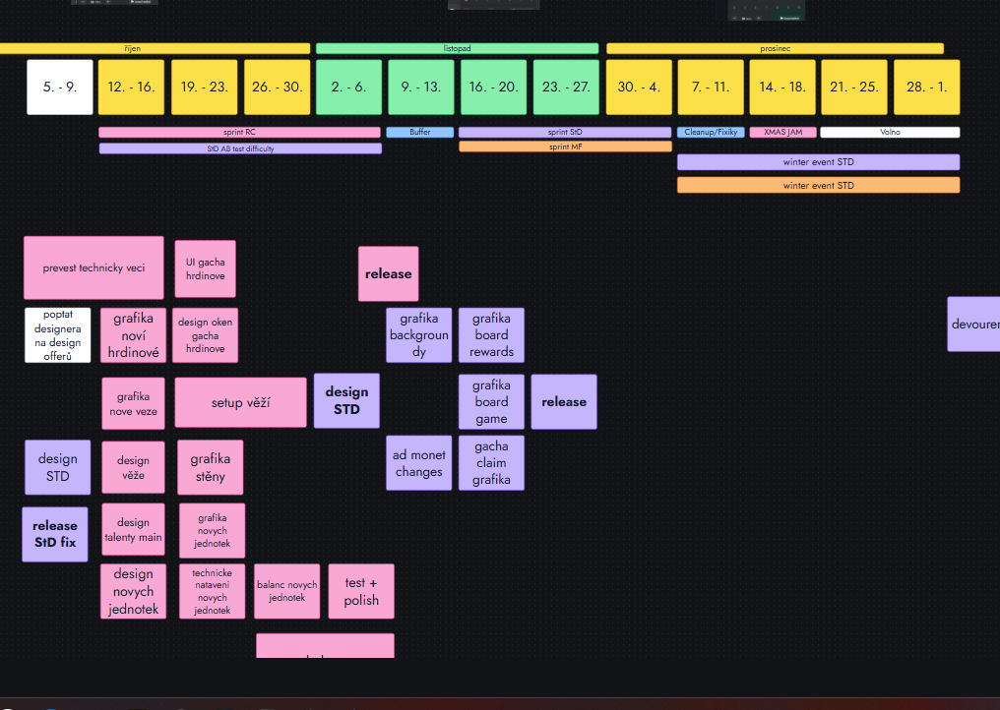

# Konec roku 2026 a GameJam

> **Stav:** 6. 11. 2026, návrh Davida, upraveno podle rozhodnutí 6. 11. (kapacita, SGB, featury Hexu, NoxEngine, CPI). Podklady: roadmapa a zpráva Aldyho z 3. 11. 2026, `STRATEGIE_PRODUKCE.md`, `KONCEPT_OBNOVA_HEXU.md`. Věci označené *(návrh)* je potřeba potvrdit.
> **Pro AI agenty:** zdrojem pravdy je tento soubor. Termíny Hexu navazují na `KONCEPT_OBNOVA_HEXU.md`, témata jamu na `CPI_PIPELINE.md` a `SHRNUTI_NOXENGINE.md`.

## 1. Shrnutí

- **Do konce roku chceme dvě věci hotové:** SharedGameBackend (SGB) vyvinutý a otestovaný na **interním buildu Mecha Fortress** a v Hexu **PvP, City V2 a UGC v testu a připravené do 11. 12.** (za RC flagy, PvP a City V2 k hráčům v lednu, UGC může jít k hráčům dřív než v únoru).
- **SGB není součástí releasu 11. 12.** K hráčům jde až po svátcích, vypnutý za flagem, a zapíná se postupně (rozhodnuto 6. 11.).
- **Kapacita (rozhodnuto 6. 11.):** vývoj hlavních live her vedou veteráni **Milan a Čoud**. SGB, PvP, City V2, UGC a nové věci si dělí **Mirek, Kubík a David**.
- **NoxEngine je letos jen experiment** (David a Čoud), kvůli němu nic z plánu nevypadává. Rozšiřovat a testovat ho jde i během GameJamu.
- **Exekutiva** má nejpozději **1. 12.** první schůzku k vyhodnocení roku 2026 a ke strategii 2027.
- **Poslední pracovní týden 14. až 18. 12. se nic nevydává.** Je to uvolněný týden ve znamení **GameJamu** s tématy pro projekty 2027 a společným **AI workshopem** na celý vývojový cyklus.
- **18. 12.** si hry projdeme a vyhodnotíme, večer **firemní párty**. Od 21. 12. volno.
- Podle Aldyho roadmapy to sedí: Red Command nejpozději 11. 11., pak sprinty Sector Defense a MF, 7. až 11. 12. úklid a opravy, 14. až 18. 12. XMAS JAM.

## 2. Kalendář do konce roku

| Týden | Produkce (Aldy) | Firma a vedení |
|---|---|---|
| 2. až 6. 11. | sprint Red Command, A/B test obtížnosti Sector Defense | |
| 9. až 13. 11. | **Red Command hotový nejpozději 11. 11.** (grafika offerů, balanc); jednotýdenní buffer, plán zbytku roku | |
| 16. až 27. 11. | sprint Sector Defense (do 4. 12.) a sprint MF (do 27. 11.) | **19. 11. porada vedení** |
| 30. 11. až 4. 12. | konec sprintu Sector Defense | **do 1. 12. schůzka exekutivy:** vyhodnocení roku a strategie 2027 |
| 7. až 11. 12. | **úklid a opravy, poslední release roku:** zimní eventy Sector Defense a MF; SGB v MF jen na interním buildu, featury Hexu v testu | |
| 14. až 18. 12. | **bez releasů: GameJam + AI workshop**, NoxEngine experiment | **18. 12. vyhodnocení her a párty** |
| 21. 12. až 1. 1. | volno, zimní eventy běží | pohotovost na live ops *(návrh)* |

Davidův návrh pro Aldyho platí: po Red Command jeden týdenní sprint na dohodu, co stihneme buď v jednom čtyřtýdenním, nebo ve dvou dvoutýdenních sprintech, tak aby poslední týden zůstal volný na jam.

## 3. Produkce do konce roku (Aldy, 3. 11.)

**Red Command:** za nás hotový **nejpozději 11. 11.** Dolaďuje se grafika offerů a balanc (hlavně Karel). Na roadmapě je sprint RC od 12. 10. s gacha hrdiny, novými věžemi, stěnami, talenty a novými jednotkami, pak test, polish a release.

**Mecha Fortress:**
- balíček **Welcome back**;
- **reskin board game eventu na Vánoce** (práce pro grafiky, Peko nebo další);
- zimní event od 7. 12.

**Sector Defense:**
- nový **A/B test obtížnosti**;
- v dalším sprintu úpravy tutorialu a drobnosti, které šly do Red Command (reklamy v metě);
- grafika backgroundů, board game a jeho odměny, grafika gacha claim, změny v ad monetizaci, release;
- Aldy s Karlem zvažují přidat aspoň **leaderboard**;
- board game na svátky a zimní event od 7. 12.

**Kapacita:** podle Aldyho jsou to menší věci a plán sedí. **Kódově bude konec roku volnější**, práce je víc na grafice. Kodéři si proto vytáhnou úkoly z backlogu a připraví začátek roku 2027. Tuto volnou kapacitu dáváme do SGB a featur v Hexu (kapitola 4).

**Rozdělení lidí (rozhodnuto 6. 11.):** vývoj hlavních live her vedou **Milan a Čoud** (Jan Š., Czode). SGB, PvP, City V2, UGC a nové věci si dělí **Mirek, Kubík (Jakub H.) a David**.

## 4. Co chce David mít hotové do konce roku

| Cíl | Co znamená hotovo | Termín |
|---|---|---|
| **SGB v Mecha Fortress** | SGB integrovaný a otestovaný na interním buildu MF, aspoň jedna služba (Nox ID, žebříčky, klany) | interní build do 11. 12., hráči po svátcích (vypnuté za flagem, zapíná se postupně) |
| **PvP v Hexu** | Skill only a All-out-power, Quick game Speed a Normal, žebříčky přes SGB, za RC flagem | v testu a připravené do 11. 12., hráči v lednu |
| **City V2 v Hexu** | verze 1 (stavění, suroviny, upgrady, budovy s meta staty) importovaná z MF stagingu, za RC flagem | v testu a připravené do 11. 12., hráči v lednu |
| **UGC v Hexu** | editor map ve hře, sdílení kódem, komunitní mapy v rotaci, za RC flagem | v testu a připravené do 11. 12., k hráčům může jít dřív než v únoru |

- **SGB začíná v Mecha Fortress** (rozhodnuto 5. 11.). MF je staging projekt pro SGB i City V2, takže integrace navazuje na práci, která už běží. Ostatní hry přebírají SGB z MF, PvP žebříčky v Hexu na něm staví.
- **SGB jde do interního buildu, ne do releasu 11. 12.** (rozhodnuto 6. 11.). Vánoční release MF tak nenese riziko nové backend integrace. K hráčům jde SGB po svátcích, vypnuté za flagem, a zapíná se postupně.
- **UGC se tím posouvá dopředu:** v konceptu obnovy Hexu šlo UGC až po lednu. Je z velké části hotové, v testu má být do 11. 12. a k hráčům může jít dřív než v únoru. Je to spíš bonus navíc k PvP a City V2.
- Všechno za vlastními RC flagy, takže implementace v prosinci neznamená release v týdnu jamu.
- Na SGB a featurách Hexu dělají Mirek, Kubík a David, live hry drží Milan a Čoud (rozhodnuto 6. 11.).

## 5. Schůzka exekutivy do 1. 12.

Navazuje na poradu 19. 11. Program *(návrh)*:

1. **Vyhodnocení roku 2026:** čísla (zisk, tržby po hrách, viz `CILE_2027.md`), co se povedlo a co ne, projekty, lidé.
2. **Strategie 2027:** schválení větví a produktů (`STRATEGIE_PRODUKCE.md`), obnova Hexu a gate Hexapolis 2.
3. **Cíle 2027 a platy:** scénář cíle, brány a preset platů, pokud se nerozhodly 19. 11.
4. **Delegace od 1. 1.:** vlastníci segmentů a projektů.
5. **Konec roku:** potvrdit release freeze, GameJam, budget a pohotovost přes svátky.

## 6. Poslední týden: bez releasů

- **Poslední release roku je 11. 12.** Zimní eventy, board game, Welcome back a všechno ostatní musí být venku do té doby.
- **14. až 18. 12. se nic nevydává.** Výjimka jen hotfix na pád hry nebo chybu, která zásadně bere revenue, se souhlasem Davida *(návrh)*.
- Live ops běží na tom, co je venku. Přes svátky jeden člověk drží pohotovost na pády a eventy *(návrh: rotace)*.
- Letos to chceme **konečně dodržet**. Proto je freeze napsaný v plánu sprintů už teď, ne až v prosinci.

## 7. GameJam 14. až 18. 12.

### Proč

- Uvolněný týden, který zároveň vyrobí **základ pro projekty 2027**.
- Každý si vyzkouší **celý vývojový cyklus s AI** sám nebo v malém týmu. Je to i trénink na workflow, které ukázal NoxEngine a Warcamp.
- **NoxEngine** je letos experiment (David a Čoud), během jamu ho jde rozšiřovat a testovat (`SHRNUTI_NOXENGINE.md`).

### Témata

| Téma | Příklad směru | Vazba na 2027 |
|---|---|---|
| **Tweaky formule Hexapolisu** | jiná mapa, kratší partie, PvP twist, nová frakce | obnova Hexu, nový Hexapolis 2 |
| **Strategické idle hry** | hry mezi Hexem a MF, rychlá strategie s PvP přesahem | strategická větev, titul #1 |
| **Twisty MF-branch** | nový žánrový háček na metě MF, jiné téma | reskiny MF a Sector Defense |
| volné | cokoliv, co obhájí přínos pro 2027 | |

Nejlepší nápady můžou jít do **CPI pipeline** v lednu *(návrh)*, viz `CPI_PIPELINE.md`.

### Program

| Den | Co |
|---|---|
| po 14. 12. dopoledne | **AI workshop: celý vývojový cyklus.** Nápad, krátký design, prototyp v Claude Code, assety přes Higgsfield (obrázky, 3D modely), build, hratelná verze. Vedou David a Czode *(návrh)* |
| po 14. 12. odpoledne | výběr tématu, týmy po 1 až 3 lidech |
| út až čt | vývoj, průběžná pomoc s AI nástroji |
| **pá 18. 12.** | **prezentace a vyhodnocení her**, večer párty |

**Výstup každého týmu:** hratelný build a jedna stránka: co to je, pro koho, proč by to mělo smysl v 2027.

**Vyhodnocení 18. 12.** *(návrh)*: každý tým 5 minut ukázka. Hodnotí se zábava, napojení na strategii 2027, proveditelnost a potenciál pro CPI test. Hlasuje celá firma, exekutiva vybere, co pokračuje.

### Budget

| Položka | Kolik |
|---|---|
| Extra účty Claude | 1 až 2 účty na dobu jamu |
| Kredity Higgsfield | generování obrázků a 3D modelů |
| Asset pack | **50 USD na člověka**, jen když o něj někdo požádá |

Částku za Claude a Higgsfield doplnit podle tarifu. Asset packy maximálně 50 USD × počet lidí, kteří o ně požádají (při 16 lidech nejvýš 800 USD).

## 8. Slabá místa a otevřené otázky

| Námitka | Proč může platit | Odpověď nebo co s tím |
|---|---|---|
| **"Kód je volnější" nesedí s tím, co do něj dáváme** | Aldyho volná kapacita platí pro jeho roadmapu. My do ní přidáváme SGB v MF a tři featury Hexu, na to jsou zhruba tři týdny (16. 11. až 4. 12.), protože 7. až 11. 12. je úklid a release. | **Rozhodnuto 6. 11.:** live hry vedou Milan a Čoud, SGB, PvP, City V2 a UGC si dělí Mirek, Kubík a David. NoxEngine je letos jen experiment, nic kvůli němu z plánu nevypadává. Všechny featury Hexu v testu do 11. 12., UGC je bonus. |
| **UGC do 11. 12. nic nezrychlí** | K hráčům mělo jít až v únoru, implementace v prosinci by brala kapacitu SGB a PvP a pak ležela za flagem. | **Rozhodnuto 6. 11.:** UGC je z velké části hotové, v testu do 11. 12. a k hráčům může jít dřív než v únoru. Je to bonus, PvP a City V2 mají přednost. |
| **SGB v MF jde ven těsně před zimním eventem** | Poslední release 11. 12. nese i Welcome back, vánoční board game a zimní event, tedy revenue nejsilnějšího období. Nová backend integrace v tomtéž buildu zvyšuje riziko, že chyba zasáhne právě event. | **Rozhodnuto 6. 11.:** SGB není v releasu 11. 12. Do konce roku se vyvíjí a testuje na interním buildu MF, k hráčům jde po svátcích vypnuté za flagem a zapíná se postupně. |
| **Hex PvP stojí na SGB, které jde nejdřív do MF** | Žebříčky PvP v Hexu mají běžet přes SGB. SGB jde k hráčům MF až po svátcích, PvP v Hexu v lednu, takže obě produkční nasazení padají do stejného období. | V K3 rozhodnout, jestli Hex PvP v testu do 11. 12. jede na SGB, nebo za flagem bez žebříčků, dokud SGB nejede v produkci. |
| **Výjimka z freeze je široká** | "Chyba, která zásadně bere revenue, se souhlasem Davida" je výklad jednoho člověka, který zároveň vede jam a workshop. | Výjimku popsat konkrétně (pád hry, rozbitý nákup, rozbitý event) a určit zástup za Davida. |
| **Pohotovost přes svátky je nedořešená** | Od 21. 12. běží zimní eventy. Jeden člověk bez přístupů ke kódu a backendu chybu jen nahlásí, nevyřeší. Pracovní pohotovost se navíc podle zákoníku práce musí dohodnout a zaplatit. | Rozpis rotace, kdo má přístupy do store, RC a SGB, kdo je eskalace na kód, a odměna. Rozhodnout do 11. 12. (K6). |
| **Jam stojí týden celé firmy a výstup může skončit v šuplíku** | 16 lidí na týden je největší jednorázový náklad celého plánu, větší než budget jamu. Ne všichni jsou vývojáři a část týmu je remote. Bez kapacity v lednu se vítězné nápady nikam neposunou. | Předem dohodnout, kdo se jamu účastní a kdo drží UA a live ops, a že vítěz dostane v lednu slot v CPI pipeline včetně kreativ. |

**Potřebuje odpověď:**

- ~~Které ze čtyř cílů jsou do 11. 12. pevné a které stretch?~~ **Rozhodnuto 6. 11.:** všechny čtyři v testu do 11. 12. (SGB na interním buildu MF), UGC je bonus.
- ~~Jde SGB v MF do produkce zapnuté, nebo za RC flagem?~~ **Rozhodnuto 6. 11.:** po svátcích, vypnuté za flagem, zapíná se postupně.
- Kdo drží pohotovost přes svátky, s jakými přístupy a za jakou odměnu?
- Je účast na jamu pro všech 16 lidí, nebo jen pro vývoj a grafiku? Jak se zapojí remote lidé?
- Kolik stojí Claude účty a Higgsfield kredity, aby šlo budget schválit 1. 12.?

## 9. K rozhodnutí

| # | Otázka | Kdo | Do kdy |
|---|---|---|---|
| K1 | Termín schůzky exekutivy (nejpozději 1. 12.) | Jirka, David | 19. 11. |
| K2 | Release freeze od 14. 12., poslední release 11. 12. | exekutiva | 19. 11. |
| K3 | Které služby SGB se do 11. 12. integrují a testují na interním buildu MF (Nox ID, žebříčky, klany). Kdo kóduje: **rozhodnuto 6. 11.**, Mirek, Kubík a David | David, Aldy | plán sprintu po 11. 11. |
| ~~K4~~ | ~~UGC implementované do konce roku: kapacita kodérů~~ **Rozhodnuto 6. 11.:** UGC v testu do 11. 12. jako bonus, kapacitu nesou Mirek, Kubík a David | David, Mirek | uzavřeno |
| K5 | Budget jamu: Claude účty, Higgsfield, asset packy | Jirka, DJ | 1. 12. |
| K6 | Pohotovost na live ops přes svátky | Martin V., Aldy | 11. 12. |
